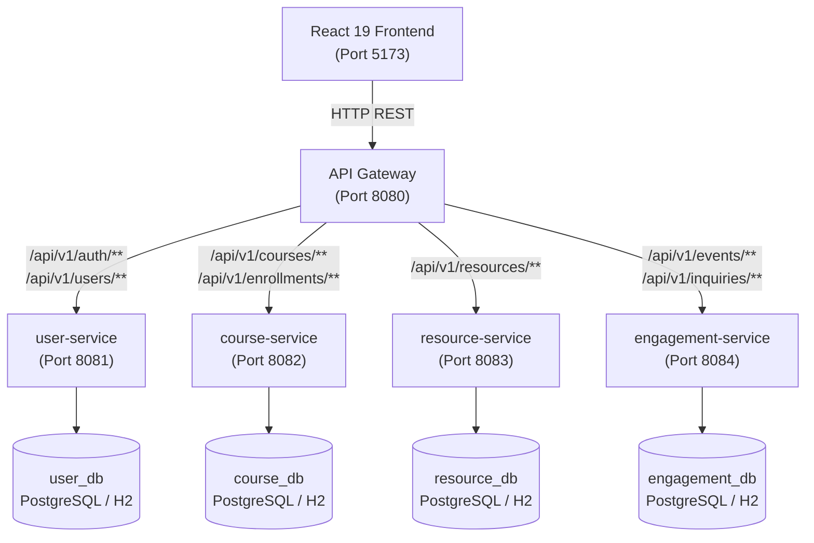
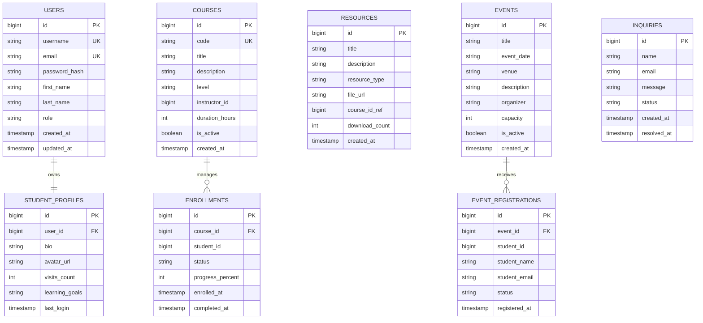

# Microservices Architecture & Engineering Reference
## Student Learning Portal

---

## 1. Architecture Principles

This project implements a genuine **Microservices Architecture** adhering strictly to enterprise distributed systems standards:

1. **Independent Microservices**: Each domain capability is packaged as a standalone, runnable Spring Boot application with its own HTTP server port and independent build lifecycle.
2. **Database-Per-Service**: Microservices own their databases exclusively (`user_db`, `course_db`, `resource_db`, `engagement_db`). Direct database access across microservices is strictly forbidden.
3. **API Gateway Pattern**: Single entry point on port `8080` handling centralized CORS, reverse proxy routing, JWT token validation, and header enrichment (`X-User-Id`, `X-User-Role`, `X-User-Email`).
4. **Internal Layered Architecture**:
   - `Controller Layer` $\rightarrow$ REST endpoints and HTTP status codes
   - `Service Layer` $\rightarrow$ Interfaces and transactional business logic implementations
   - `Repository Layer` $\rightarrow$ Spring JDBC data access with type-safe RowMappers
   - `DTO Layer` $\rightarrow$ Request/Response separation with Jakarta Bean Validation
   - `Exception Layer` $\rightarrow$ `@RestControllerAdvice` with standard `ErrorResponse` envelope
5. **Frontend Client**: React 19 + Vite frontend consuming backend services via the API Gateway while preserving all React syllabus topics (`useState`, `useEffect`, `useContext`, `useMemo`, `useRef`, `useGreeting`, `useLocalStorage`, `useDebugValue`).

---

## 2. Distributed Architecture Diagram

---

## 3. Database Ownership Matrix

---

## 4. API Endpoints Catalog

### Authentication & User Service (`user-service`: 8081)
- `POST /api/v1/auth/register` $\rightarrow$ Register new student/faculty
- `POST /api/v1/auth/login` $\rightarrow$ Authenticate and receive JWT token
- `GET /api/v1/auth/me` $\rightarrow$ Get authenticated user details
- `GET /api/v1/users/profile` $\rightarrow$ Get student profile (visits, bio, goals)
- `PUT /api/v1/users/profile` $\rightarrow$ Update student profile
- `POST /api/v1/users/profile/visit` $\rightarrow$ Record portal visit

### Course & Enrollment Service (`course-service`: 8082)
- `GET /api/v1/courses` $\rightarrow$ List all published courses
- `GET /api/v1/courses?level=Beginner` $\rightarrow$ Filter courses by level
- `GET /api/v1/courses/{id}` $\rightarrow$ Retrieve course details
- `POST /api/v1/courses` $\rightarrow$ Create course (Instructor/Admin)
- `POST /api/v1/enrollments` $\rightarrow$ Enroll student into a course
- `GET /api/v1/enrollments/student/{studentId}` $\rightarrow$ Retrieve student enrollments
- `PUT /api/v1/enrollments/{id}/progress` $\rightarrow$ Update course completion percentage

### Resource Service (`resource-service`: 8083)
- `GET /api/v1/resources` $\rightarrow$ List all study resources
- `GET /api/v1/resources?type=NOTES` $\rightarrow$ Filter by type (NOTES, EXERCISES, PROJECTS, CHEATSHEET)
- `GET /api/v1/resources/{id}` $\rightarrow$ Retrieve resource metadata
- `POST /api/v1/resources` $\rightarrow$ Upload new learning asset
- `POST /api/v1/resources/{id}/download` $\rightarrow$ Increment download metric & access resource

### Engagement & Support Service (`engagement-service`: 8084)
- `GET /api/v1/events` $\rightarrow$ Retrieve scheduled campus & virtual events
- `POST /api/v1/events` $\rightarrow$ Create new event/workshop
- `POST /api/v1/events/{id}/register` $\rightarrow$ Register student RSVP for an event
- `POST /api/v1/inquiries` $\rightarrow$ Submit contact form support message
- `GET /api/v1/inquiries` $\rightarrow$ List inquiries (Support admin)
- `PUT /api/v1/inquiries/{id}/status` $\rightarrow$ Update inquiry resolution status

### API Gateway (`api-gateway`: 8080)
- Proxies all `/api/v1/**` requests to corresponding microservices.
- `GET /api/v1/gateway/status` $\rightarrow$ Gateway and route routing matrix
- `GET /api/v1/gateway/health` $\rightarrow$ Real-time downstream service health ping

---

## 5. Verification & Testing Evidence

All microservices maintain independent test suites with JUnit 5 and Mockito.

| Microservice | Test Suite | Tests Run | Failures | Status |
|---|---|---|---|---|
| `user-service` | `AuthServiceTest` | 4 | 0 | **PASSED** |
| `course-service` | `CourseServiceTest` | 4 | 0 | **PASSED** |
| `resource-service`| `ResourceServiceTest` | 3 | 0 | **PASSED** |
| `engagement-service`| `EventServiceTest` | 4 | 0 | **PASSED** |
| `api-gateway` | `JwtValidatorTest` | 2 | 0 | **PASSED** |
| **Frontend** | `Vite 7 Production Build`| 60 modules | 0 | **BUILT (dist/)** |

Total tests executed across all microservices: **17 tests, 0 failures, 100% success rate**.

