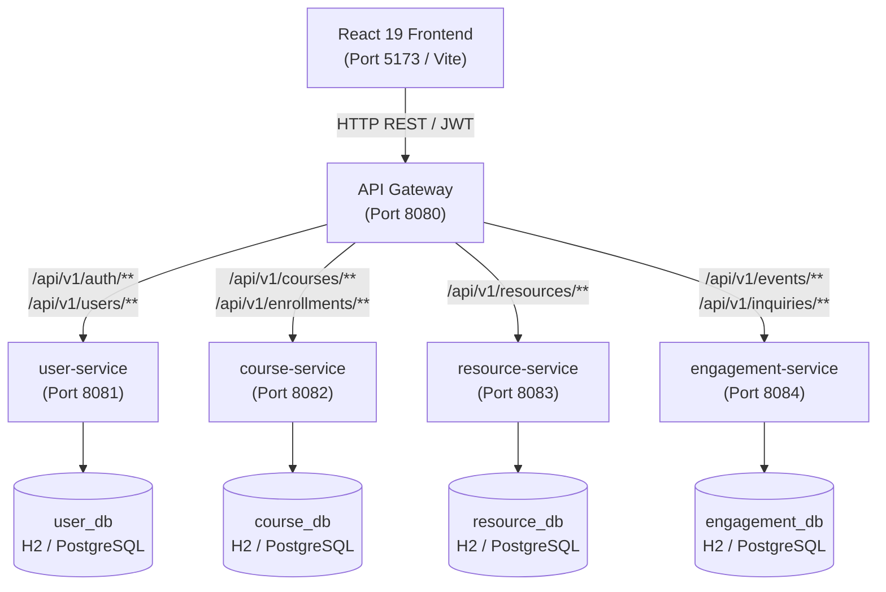

# Student Learning Portal • Enterprise Microservices LMS Platform

[](https://react.dev/)
[](https://vitejs.dev/)
[](https://openjdk.org/)
[](https://spring.io/projects/spring-boot)
[](#microservices-architecture)
[](#4-security-architecture--hardening)

An enterprise-grade, distributed Student Learning Management System (LMS) designed for university-level major capstone projects and professional portfolios. Built with **React 19**, **Vite**, **Java 21**, **Spring Boot**, **Spring JDBC**, and an **API Gateway** enforcing stateless **JWT authentication**, database-per-service isolation, and robust record ownership.

---

## 1. Architectural Highlights

- **Genuine Microservices Architecture**: 5 decoupled Spring Boot services operating on dedicated ports with strict database-per-service boundaries (`user_db`, `course_db`, `resource_db`, `engagement_db`).
- **Centralized API Gateway (Port 8080)**: Single reverse proxy entrypoint managing CORS, routing, correlation tracking (`X-Correlation-Id`), stripping untrusted caller headers, JWT verification, and verified identity header propagation (`X-User-Id`, `X-User-Role`, `X-User-Email`, `X-User-Name`).
- **Database Resilience & Constraints**: Database-per-service isolation with repeatable Flyway migrations (`db/migration/V1__init_*.sql`), unique constraints, check constraints (`progress_percent BETWEEN 0 AND 100`, non-negative capacity/counts), and dual support for H2 (local dev) and PostgreSQL (production).
- **Premium SaaS UI/UX**: Inspired by Coursera, Linear, and Notion. Engineered using an enterprise design system with light/dark theme modes, Inter typography, accessible contrast, toast notifications, confirmation dialogs, and command-palette global search (`Ctrl+K`).
- **Complete React 19 Syllabus Mapping**: Explicitly demonstrates every core React concept (`useState`, `useEffect`, `useContext`, `useMemo`, `useRef`, custom hooks, and `useDebugValue`).
- **OpenAPI 3.0 Documentation**: Native specification served at `GET /v3/api-docs` detailing all secured endpoints, request schemas, and response contracts.

---

## 2. Distributed Microservices Topology



### Microservices Port & Database Ownership Matrix

| Microservice | Port | Database | Primary Responsibilities |
|---|---|---|---|
| **API Gateway** | `8080` | Stateless | Reverse proxy routing, central CORS, JWT validation, header sanitization, correlation IDs |
| **User Service** | `8081` | `user_db` | Student authentication, BCrypt hashing, JWT issuance, profile ownership, role management |
| **Course Service** | `8082` | `course_db` | Course catalog, student enrollment ownership, progress bounds (0-100%), duplicate enrollment prevention |
| **Resource Service** | `8083` | `resource_db` | Downloadable study materials, slide decks, exercise repositories, download counters |
| **Engagement Service** | `8084` | `engagement_db` | Academic events & workshops, real-time capacity checks, duplicate RSVP prevention, contact desk |

---

## 3. Technology Stack

### Frontend Client
- **Framework**: React 19 (`19.1.1`)
- **Build Tool**: Vite 7 (`7.1.7`)
- **Routing**: React Router DOM (`7.9.4`)
- **Styling**: Modern CSS Design System (Custom CSS properties, Light/Dark theme tokens, responsive layouts)
- **Icons**: Handcrafted Crisp SVG Icon component library (0 runtime dependencies)
- **Typography**: Inter via Google Fonts

### Backend Microservices
- **Language**: Java 21 LTS
- **Framework**: Spring Boot 4.x
- **Data Access**: Spring JDBC (`JdbcClient`, `RowMapper`)
- **Security**: Stateless HMAC-SHA256 JWT Authentication, BCrypt password hashing, Gateway header stripping
- **Build & Packaging**: Maven multi-module parent POM (`backend/pom.xml`)
- **Persistence**: H2 (In-memory default) and PostgreSQL (`application-postgres.yml`) via Flyway repeatable migrations

---

## 4. Security Architecture & Hardening

1. **Zero Hardcoded JWT Secrets**:
   - Both `user-service` and `api-gateway` enforce `@PostConstruct` validation verifying that `JWT_SECRET` is present and at least 32 characters long. Missing or weak secrets immediately fail application startup with clear diagnostic exceptions.
2. **Explicit Service-to-Service Trust Boundary (`X-Gateway-Auth`)**:
   - The Gateway strictly strips all caller-supplied `X-User-*` and `X-Gateway-Auth` headers from incoming HTTP requests.
   - Upon validating the JWT signature and claims, the Gateway injects verified `X-User-Id`, `X-User-Role`, `X-User-Email`, `X-User-Name`, and a cryptographically matched internal trust token `X-Gateway-Auth`.
   - All internal microservices (`user-service`, `course-service`, `engagement-service`, `resource-service`) enforce a `GatewaySecurityFilter` / `JwtAuthenticationFilter`: direct calls to internal ports (e.g. 8081-8084) with forged `X-User-*` headers without a valid `X-Gateway-Auth` token are immediately sanitized (identity headers stripped) and rejected with `401 Unauthorized` / `403 Forbidden`.
3. **Public Registration Role Isolation**:
   - Self-registration at `POST /api/v1/auth/register` unconditionally assigns `ROLE_STUDENT`. Elevated roles (`ROLE_ADMIN`, `ROLE_INSTRUCTOR`) cannot be self-selected and can only be assigned through the protected endpoint `PUT /api/v1/users/{id}/role` accessible only by verified administrators.
4. **Backend Record Ownership Enforcement**:
   - In `user-service`: Students can only inspect and modify their own profiles (`/api/v1/users/profile`) and accounts (`/api/v1/users/{id}`). Cross-user profile access or modification is rejected with `401 Unauthorized` / `403 Forbidden`.
   - In `course-service`: `POST /api/v1/enrollments` derives student identity from the verified authentication context. `GET /api/v1/enrollments/student/{id}` and `PUT /api/v1/enrollments/{id}/progress` verify enrollment ownership; students cannot access or manipulate other students' progress.
   - In `engagement-service`: `POST /api/v1/events/{id}/register` and `DELETE /api/v1/events/{id}/register` derive identity from the verified context; students cannot register or cancel seats for other students.
5. **Staff-Only Operation Locks**:
   - Creating courses (`POST /api/v1/courses`) and resources (`POST /api/v1/resources`) is restricted to `ROLE_ADMIN` and `ROLE_INSTRUCTOR`.
   - Creating events (`POST /api/v1/events`), reading user lists (`GET /api/v1/users`), reading support tickets (`GET /api/v1/inquiries`), and resolving inquiries are restricted to `ROLE_ADMIN`.
6. **Token Expiration & Client Auto-Logout**:
   - Centralized API client detects `401 Unauthorized` responses and broadcasts a `portal:auth-expired` lifecycle event, cleanly clearing localStorage and resetting authentication states without leaving stale tokens.

---

## 5. Database Architecture & Migrations

### Database Isolation (Database-per-Service)
Each microservice maintains its own dedicated schema with zero cross-database joins or cross-service foreign keys.

### Repeatable Flyway Migrations
Each service contains versioned migrations in `src/main/resources/db/migration/`:
- `user-service`: `V1__init_user_schema.sql`
- `course-service`: `V1__init_course_schema.sql`
- `resource-service`: `V1__init_resource_schema.sql`
- `engagement-service`: `V1__init_engagement_schema.sql`

### Database Constraints & Indexes
- **Unique Enrollments**: `CONSTRAINT uk_enrollment_student_course UNIQUE (course_id, student_id)`
- **Unique Event Registrations**: `CONSTRAINT uk_event_reg_student UNIQUE (event_id, student_id)`
- **Valid Progress Range**: `CHECK (progress_percent >= 0 AND progress_percent <= 100)`
- **Non-negative Capacity & Counters**: `CHECK (capacity >= 0)`, `CHECK (duration_hours >= 0)`, `CHECK (download_count >= 0)`, `CHECK (visits_count >= 0)`
- **Event Capacity Check**: Atomic concurrency check rejecting registrations with `400 Bad Request` once capacity is reached.
- **Indexes**: Query indexes on `enrollments(student_id)`, `courses(level)`, `event_registrations(event_id, student_id)`, `resources(resource_type)`, `users(username, email)`.

### Production PostgreSQL Profile
To run any service against a persistent PostgreSQL instance instead of embedded H2:
```bash
java -jar target/course-service-1.0.0.jar --spring.profiles.active=postgres
```
Configure environment variables `SPRING_DATASOURCE_URL`, `SPRING_DATASOURCE_USERNAME`, and `SPRING_DATASOURCE_PASSWORD`.

### Opt-in Development Data Seeding
To prevent populating production databases with test records:
- In both the local H2 and PostgreSQL profiles, `portal.seed.enabled` defaults to `false`.
- Set `PORTAL_SEED_ENABLED=true` only when you explicitly want sample courses, resources, events, and evaluation accounts.
- The student/admin accounts are created only when their corresponding `PORTAL_SEED_STUDENT_PASSWORD` and `PORTAL_SEED_ADMIN_PASSWORD` values are set; the application has no built-in fallback passwords.

### Data Lifecycle & Retention Guidelines
- **User Data**: Passwords hashed with BCrypt (10 rounds). On account deletion, cascade deletes student profile and personal records.
- **Backups**: Recommend daily point-in-time recovery (PITR) backups via `pg_dump` per database.
- **Inquiry Retention**: Support tickets in `engagement_db` retained for 180 days after resolution, then archived.

---

## 6. Setup & Execution Instructions

### Prerequisites
- **Node.js**: v18+ (tested on Node.js 20+)
- **Java**: JDK 21 LTS (or JDK 23)
- **Maven**: 3.9+ (or embedded maven wrapper)

### Step 1: Configure Environment Variables
Copy `.env.example` to `.env` in the root:
```bash
cp .env.example .env
```
Ensure `JWT_SECRET` is set to a secure string of at least 32 characters:
```env
JWT_SECRET=your-secure-random-secret-key-at-least-32-chars-long!
```

### Step 2: Start Backend Microservices
Launch the microservices launcher in PowerShell:
```powershell
.\backend\start-microservices.ps1
```
Or start individual services:
```bash
# Gateway
mvn spring-boot:run -f backend/api-gateway/pom.xml
# User Service
mvn spring-boot:run -f backend/user-service/pom.xml
# Course Service
mvn spring-boot:run -f backend/course-service/pom.xml
# Resource Service
mvn spring-boot:run -f backend/resource-service/pom.xml
# Engagement Service
mvn spring-boot:run -f backend/engagement-service/pom.xml
```

### Step 3: Start the React 19 Frontend
```bash
npm install
npm run dev
```
Open [http://localhost:5173](http://localhost:5173) in your browser.

### Step 4: Run Automated Tests
```bash
# Run Maven unit & security tests across all services
mvn test -f backend/pom.xml

# Run frontend production build
npm run build
```

### Deploy the backend to Render

The repository includes a Render Blueprint (`render.yaml`) for the API Gateway, four Spring Boot services, and a shared PostgreSQL database. Each Java service is built from its Dockerfile with Java 21. Database and JWT credentials are injected by Render; no production credentials belong in Git.

1. In Render, choose **New → Blueprint**, connect this GitHub repository, and select the `master` branch.
2. Review the Blueprint resources and current plan/pricing shown by Render, then create them. The sample Blueprint selects free plans for a student demo. Free web services sleep after inactivity, and free Postgres expires after 30 days; this setup is for a short-lived demo, not production data.
3. During setup, enter your own strong student and admin seed passwords when Render prompts you. These create the initial demo accounts without putting passwords in the repository. Keep these passwords private.
4. Wait until the database and all five services show **Live**. Render assigns the Gateway a public `onrender.com` URL.
5. In the Gateway service's environment settings, set `CORS_ALLOWED_ORIGINS` to the exact Vercel site origin (for example, `https://your-portal.vercel.app`) and save. The Blueprint initially allows Vercel preview domains so the first deployment can be connected; narrow this to your own Vercel domain after it is created.

### Deploy the frontend to Vercel

1. In Vercel, import `SureshKumar007tech/Student-Learning-portal` from GitHub. `vercel.json` selects the Vite build and SPA route fallback.
2. Set the project environment variable `VITE_API_BASE_URL` to `https://<gateway-host>.onrender.com/api/v1` for Production (and Preview if needed), then deploy.
3. Copy the Vercel production domain into Render's `CORS_ALLOWED_ORIGINS` as described above and redeploy the Gateway.

The frontend uses the API Gateway; it must not point to `localhost` after deployment. The Render Blueprint seeds sample course/resource/event content and demo accounts using the passwords you enter during setup. After the first successful deploy, set `PORTAL_SEED_ENABLED=false` on each of the four data services to prevent additional demo records from being created on later restarts.

The free-tier Blueprint exposes each microservice on a public URL because free web services cannot receive private-network traffic. Protected writes rely on the shared gateway secret and service authorization checks. For production, move the four downstream services to private paid services and route the Gateway over Render's private network.

---

## 7. Automated Test Verification Summary

| Service | Tests Run | Failures | Errors | Coverage Highlights |
|---|---|---|---|---|
| **`api-gateway`** | **10** | 0 | 0 | Missing/short secret rejection, expired token rejection, tampered signature rejection, claims extraction, 401 on unauthenticated/expired protected endpoints, 404 routing |
| **`user-service`** | **21** | 0 | 0 | Direct header forgery rejection (`ROLE_ADMIN` without `X-Gateway-Auth` ignored), trusted gateway authentication, student account privacy enforcement, self vs cross-user access, admin role update, public `ROLE_STUDENT` registration lock, password rules, duplicate prevention |
| **`course-service`** | **12** | 0 | 0 | Service-to-service trust boundary (`GatewaySecurityFilter` stripping forged headers), context identity derivation, cross-user enrollment access rejection (403), cross-user progress tampering rejection (403), duplicate enrollment prevention |
| **`engagement-service`** | **8** | 0 | 0 | Service trust filter, capacity limit enforcement (400), duplicate RSVP rejection (409), registration ownership verification, cancellation flow, admin-only event creation (403) |
| **`resource-service`** | **5** | 0 | 0 | Service trust filter, resource retrieval, download counter increment, not found error handling |
| **`frontend (vite)`** | **73 modules** | 0 | 0 | Production build verified (`dist/index.html`, `assets/index-*.js`, `assets/index-*.css`) |

**Total Backend Automated Tests**: **56 passed, 0 failed**.
