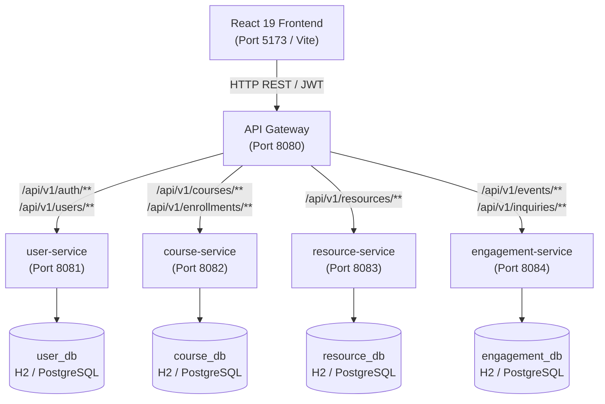

# Student Learning Portal • Enterprise Microservices LMS Platform

[](https://react.dev/)
[](https://vitejs.dev/)
[](https://openjdk.org/)
[](https://spring.io/projects/spring-boot)
[](#microservices-architecture)

An enterprise-grade, distributed Student Learning Management System (LMS) designed for university-level major capstone projects and professional portfolios. Built with **React 19**, **Vite**, **Java 21**, **Spring Boot**, **Spring JDBC**, and an **API Gateway** enforcing stateless **JWT authentication** and database-per-service isolation.

---

## 1. Architectural Highlights

- **Genuine Microservices Architecture**: 5 decoupled Spring Boot services operating on dedicated ports with strict database-per-service boundaries (`user_db`, `course_db`, `resource_db`, `engagement_db`).
- **Centralized API Gateway (Port 8080)**: Single reverse proxy entrypoint managing CORS, routing, JWT verification, and identity header propagation (`X-User-Id`, `X-User-Role`, `X-User-Email`).
- **Premium SaaS UI/UX**: Inspired by Coursera, Linear, and Notion. Engineered using an enterprise design system with light/dark theme modes, Inter typography, accessible contrast, toast notifications, confirmation dialogs, and command-palette global search (`Ctrl+K`).
- **Complete React 19 Syllabus Mapping**: Explicitly demonstrates every core React concept (`useState`, `useEffect`, `useContext`, `useMemo`, `useRef`, custom hooks, and `useDebugValue`).
- **Role-Based Access Control (RBAC)**: Distinct permissions and views for Students and Administrators (`ROLE_STUDENT` vs `ROLE_ADMIN`).

---

## 2. Distributed Microservices Topology



### Microservices Port & Database Ownership Matrix

| Microservice | Port | Database | Primary Responsibilities |
|---|---|---|---|
| **API Gateway** | `8080` | Stateless | Reverse proxy routing, central CORS, JWT validation, header enrichment |
| **User Service** | `8081` | `user_db` | Student & Faculty authentication, BCrypt hashing, JWT issuance, profile persistence |
| **Course Service** | `8082` | `course_db` | Course catalog, prerequisites, student enrollment tracking, progress percent sync |
| **Resource Service** | `8083` | `resource_db` | Downloadable study materials, slide decks, exercise repositories, download counters |
| **Engagement Service** | `8084` | `engagement_db` | Academic events & workshops, RSVP confirmations, contact & support inquiry desk |

---

## 3. Technology Stack

### Frontend Client
- **Framework**: React 19 (`19.1.1`)
- **Build Tool**: Vite 7 (`7.1.7`)
- **Routing**: React Router DOM (`7.9.4`)
- **Styling**: Modern CSS Design System (Custom CSS properties, Light/Dark theme tokens, responsive layouts)
- **Icons**: Handcrafted Crisp SVG Icon component library (0 runtime bloat)
- **Typography**: Inter via Google Fonts

### Backend Microservices
- **Language**: Java 21 LTS
- **Framework**: Spring Boot 4.x
- **Data Access**: Spring JDBC (`JdbcTemplate`, `RowMapper`)
- **Security**: Stateless HMAC-SHA256 JWT Authentication, BCrypt password hashing
- **Build & Packaging**: Maven multi-module parent POM (`backend/pom.xml`)
- **Embedded Database**: H2 (In-memory / file-persisted) with seamless PostgreSQL compatibility

---

## 4. UI/UX Design System

The visual identity follows modern enterprise guidelines:
- **Primary Background**: `#F5F7FB` (Light) / `#0B1324` (Dark Navy)
- **Surfaces & Cards**: `#FFFFFF` (Light) / `#132039` (Dark)
- **Primary Accent**: `#2563EB` (Tailwind Blue-600)
- **Secondary Accent**: `#06B6D4` (Cyan-500)
- **Text Hierarchy**: `#172033` (High contrast primary) / `#475569` (Secondary) / `#64748B` (Muted)
- **Feedback & States**: Toast alert notifications, accessible modal confirmation dialogs, loading spinners, empty-state screens.

---

## 5. React 19 Syllabus Mapping (Viva Examination Guide)

| # | Syllabus Topic | Implementation Location | Description |
|---|---|---|---|
| 1 | **Foundation of React** | [main.jsx](file:///src/main.jsx), [App.jsx](file:///src/App.jsx) | React 19 StrictMode root mounting and SPA initialization |
| 2 | **JSX** | All components in `src/components/` and `src/pages/` | Semantic, accessible JSX rendering |
| 3 | **Components** | `src/components/*` | Reusable UI atoms and molecules (Header, Navbar, CourseCard, ResourceCard, etc.) |
| 4 | **Events** | `onClick`, `onChange`, `onSubmit` | Synchronous state handlers and form preventDefault event handling |
| 5 | **Forms** | [ContactForm.jsx](file:///src/components/ContactForm.jsx), [AuthModal.jsx](file:///src/components/AuthModal.jsx) | Controlled form components with input validation |
| 6 | **Refs** | [ContactForm.jsx](file:///src/components/ContactForm.jsx), [FocusDemo.jsx](file:///src/components/FocusDemo.jsx) | `useRef` directly accessing imperative DOM focus methods |
| 7 | **Styling React** | [styles.css](file:///src/styles.css) | Custom CSS design tokens, dynamic `.dark` class switching |
| 8 | **Routing** | [App.jsx](file:///src/App.jsx) | `react-router-dom` v7 Route definitions and dynamic URL mapping |
| 9 | **Rules of Hooks** | All hooks and components | Strict top-level declaration without conditional wrapping |
| 10 | **useState** | [Dashboard.jsx](file:///src/pages/Dashboard.jsx), [Courses.jsx](file:///src/pages/Courses.jsx) | Reactive state management for progress sliders, filters, and forms |
| 11 | **useEffect** | [App.jsx](file:///src/App.jsx), [FocusDemo.jsx](file:///src/components/FocusDemo.jsx) | Document title updates, gateway status polling, and API data fetching |
| 12 | **useContext** | [ThemeContext.jsx](file:///src/hooks/ThemeContext.jsx), [AuthContext.jsx](file:///src/hooks/AuthContext.jsx), [ToastContext.jsx](file:///src/hooks/ToastContext.jsx) | Global state for Dark/Light theme, Auth tokens, and Toast alerts |
| 13 | **useMemo** | [App.jsx](file:///src/App.jsx), [Courses.jsx](file:///src/pages/Courses.jsx) | Memoization of multi-attribute course and resource filtering |
| 14 | **useRef** | [FocusDemo.jsx](file:///src/components/FocusDemo.jsx) | Direct input element focus demonstration |
| 15 | **Custom Hooks** | [useGreeting.js](file:///src/hooks/useGreeting.js), [useLocalStorage.js](file:///src/hooks/useLocalStorage.js) | Encapsulated stateful reusable hooks |
| 16 | **useDebugValue** | [useGreeting.js](file:///src/hooks/useGreeting.js), [useLocalStorage.js](file:///src/hooks/useLocalStorage.js) | React DevTools custom hook inspector labeling |

---

## 6. Local Environment Configuration

Copy `.env.example` to `.env` in the project root before starting the application. Replace `JWT_SECRET` with a private, randomly generated value of at least 32 characters. The backend launcher reads this file and passes the values to the microservices; Vite reads the `VITE_` settings for the frontend.

Optional `PORTAL_SEED_STUDENT_PASSWORD` and `PORTAL_SEED_ADMIN_PASSWORD` values create local evaluation accounts on first startup. Leave them empty to disable default account seeding. Do not commit `.env` or share seeded passwords.

---

## 7. Setup & Execution Instructions

### Prerequisites
- **Node.js**: v18+ (tested on Node.js 20+)
- **Java**: JDK 21 LTS
- **Maven**: 3.9+ (or embedded maven wrapper)

### Step 1: Start Backend Microservices
Run the automated launch script in PowerShell:

```powershell
# From the project root
.\backend\start-microservices.ps1
```

This launches all 5 Spring Boot microservices on ports 8080 through 8084 in independent terminal processes.

### Step 2: Start the React 19 Frontend
Open a new terminal window:

```bash
# Install frontend dependencies (if not already installed)
npm install

# Start Vite development server
npm run dev
```

Open [http://localhost:5173](http://localhost:5173) in your browser.

### Step 3: Production Build & Verification
```bash
# Build React frontend for production
npm run build

# Run Backend Maven Tests across all 5 services
.\backend\package-all.ps1
```

---

## 8. API Gateway Endpoints Catalog

All client requests route through `http://localhost:8080/api/v1/**`:

### User & Authentication (`user-service`: 8081)
- `POST /api/v1/auth/register` — Register student or faculty
- `POST /api/v1/auth/login` — Authenticate and receive JWT
- `GET  /api/v1/auth/me` — Inspect current authenticated user
- `GET  /api/v1/users/profile` — Retrieve student learning profile
- `PUT  /api/v1/users/profile` — Update student bio and goals
- `POST /api/v1/users/profile/visit` — Record portal session visit
- `GET  /api/v1/users` — List registered users (Admin)

### Course & Enrollment (`course-service`: 8082)
- `GET  /api/v1/courses` — List courses (supports `?level=Beginner`)
- `GET  /api/v1/courses/{id}` — Course details
- `POST /api/v1/courses` — Publish new course (Admin)
- `POST /api/v1/enrollments` — Enroll student into course
- `GET  /api/v1/enrollments/student/{studentId}` — Retrieve student enrollments
- `PUT  /api/v1/enrollments/{id}/progress` — Update completion percentage

### Learning Resources (`resource-service`: 8083)
- `GET  /api/v1/resources` — List study resources (supports `?type=NOTES`)
- `GET  /api/v1/resources/{id}` — Resource metadata
- `POST /api/v1/resources` — Upload new study asset (Admin)
- `POST /api/v1/resources/{id}/download` — Increment download metric

### Engagement & Support (`engagement-service`: 8084)
- `GET  /api/v1/events` — List academic events and workshops
- `POST /api/v1/events` — Schedule new workshop (Admin)
- `POST /api/v1/events/{id}/register` — Confirm student RSVP
- `POST /api/v1/inquiries` — Submit contact form support inquiry
- `GET  /api/v1/inquiries` — Retrieve student support queue (Admin)
- `PUT  /api/v1/inquiries/{id}/status` — Update inquiry resolution status

### Gateway Health & Status (`api-gateway`: 8080)
- `GET  /api/v1/gateway/status` — Gateway route mappings
- `GET  /api/v1/gateway/health` — Real-time health ping of all downstream microservices

---

## 9. Security & Architecture Best Practices

- **Zero Hardcoded Secrets**: Secrets and endpoints are configured via environment properties (`application.yml` and `.env.example`).
- **Stateless Authorization**: JWT tokens contain user identity claims signed with HMAC-SHA256; microservices validate incoming requests without server-side session state.
- **Fail-Safe Offline Mode**: If microservices are not yet started, the React frontend gracefully activates local fallback data so evaluators can inspect every page and interaction without crashing.
